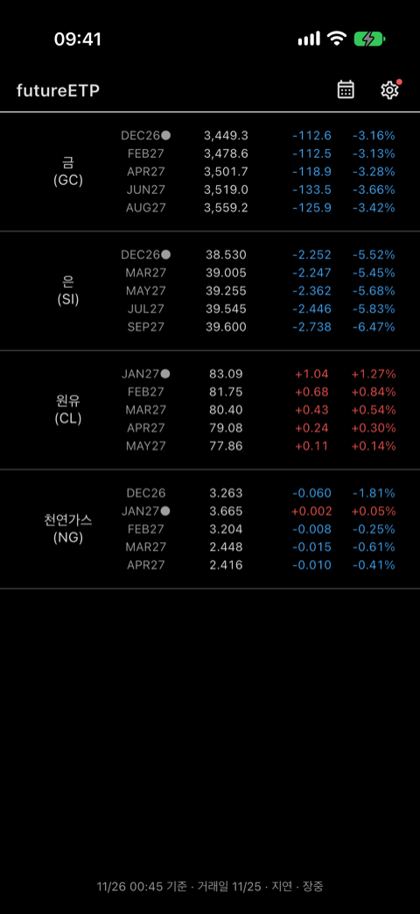
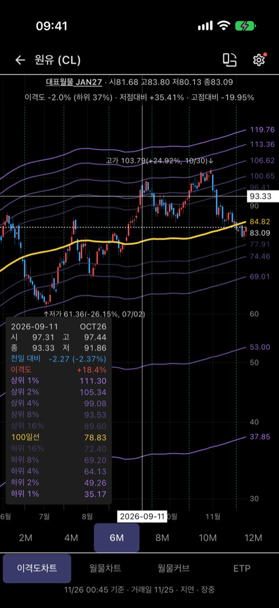
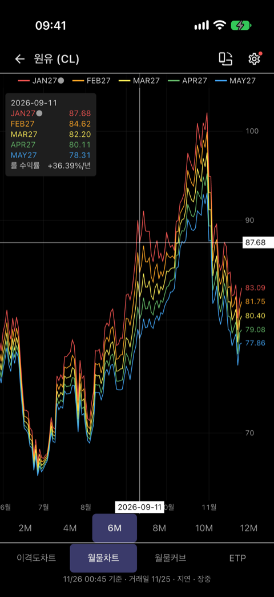
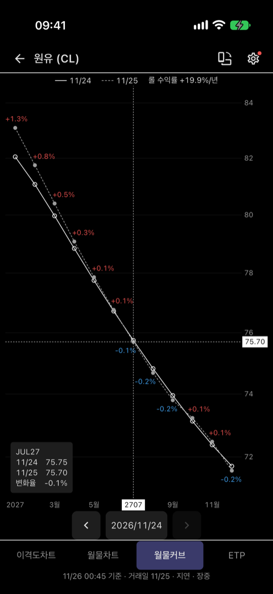
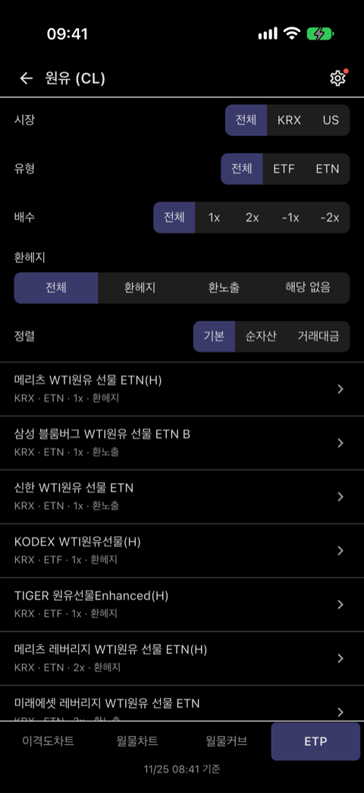
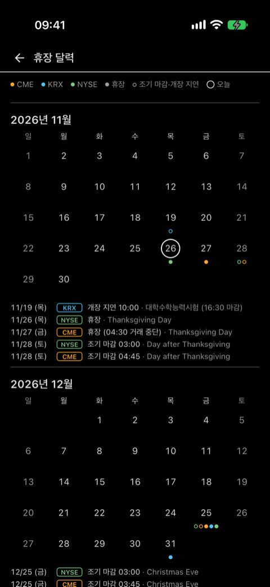
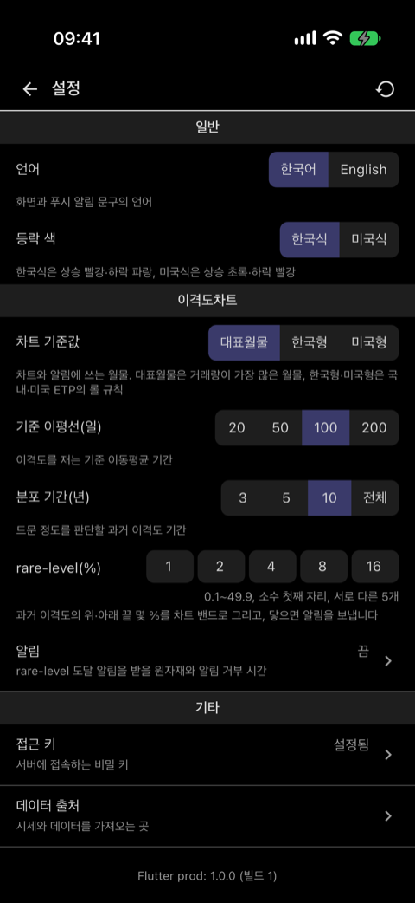
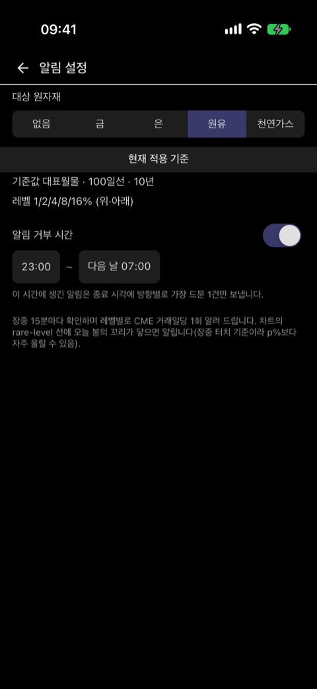
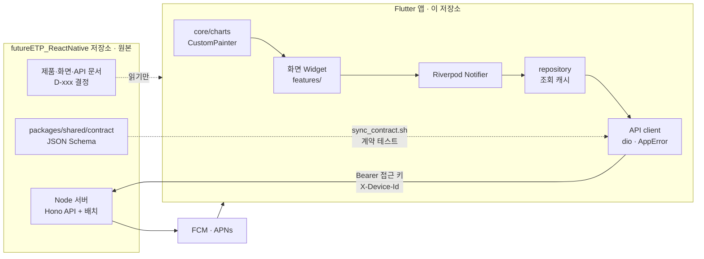
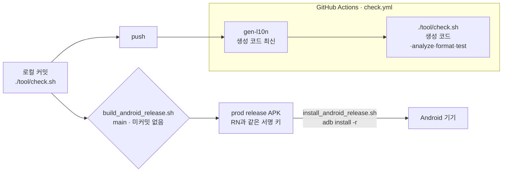

# futureETP (Flutter)

원자재 선물 기반 ETP(ETF/ETN)에 투자할 때 필요한데 기존 시세 서비스에는 없는 정보를 보여 주는 개인용 모바일 앱 futureETP의 Flutter 클라이언트입니다.
Android·iOS, 사용자 본인 1명용(스토어 미배포)이고, React Native 원본 앱([futureETP_ReactNative](https://github.com/seyoun10/futureETP_ReactNative))과 기능·화면·동작을 똑같이 맞춰 만들었습니다.

<table>
  <tr>
    <th>원자재 목록</th>
    <th>이격도차트</th>
    <th>월물차트</th>
    <th>월물커브</th>
  </tr>
  <tr>
    <td></td>
    <td></td>
    <td></td>
    <td></td>
  </tr>
  <tr>
    <th>ETP 목록</th>
    <th>휴장 달력</th>
    <th>설정</th>
    <th>알림 설정</th>
  </tr>
  <tr>
    <td></td>
    <td></td>
    <td></td>
    <td></td>
  </tr>
</table>

iOS 시뮬레이터(iPhone Air)에서 prod 서버에 붙어 찍은 화면입니다. 같은 화면의 RN 앱 모습은 원본 저장소의 [README](https://github.com/seyoun10/futureETP_ReactNative#readme)에 있습니다.

## 왜 만들었나

원유·천연가스·금·은 ETP는 실물이 아니라 선물을 보유하고, 상품마다 정해진 규칙으로 월물을 롤오버합니다.
그런데 인베스팅·트레이딩뷰 같은 서비스는 자기 기준의 "대표 월물" 시세만 보여 줍니다.
그래서 내가 산 ETP가 실제로 따라가는 가격 흐름, 롤오버 비용, 지금 가격이 역사적으로 얼마나 드문 구간인지 알기 어렵습니다.

같은 서버·API 계약 위에 RN·Flutter·SwiftUI·Kotlin 앱을 각각 만들어, 플랫폼마다 같은 제품을 어떻게 구현하는지 비교합니다. 이 저장소는 그중 Flutter 구현입니다.

## 주요 기능

- **이격도차트**: ETP 롤 규칙으로 월물을 혼합한 수익률 연결 지수를 봉차트로 그리고 롤 구간을 표시합니다. 이동평균선, rare 레벨 밴드, 고점·저점 대비 등락을 함께 보여 줍니다.
- **월물커브**: 기준일과 그다음 거래일의 커브를 겹쳐 월물별 변화율, 콘탱고/백워데이션, 연 환산 롤 수익률을 보여 줍니다(기준일 휠 시트로 2010년 이후 아무 날이나 선택).
- **월물차트·ETP 목록**: 월물별 가격 비교와 양끝 월물의 연 환산 롤 수익률, 해당 원자재를 추종하는 국내(KRX)·미국 ETP의 롤 규칙·배수·보수·거래대금을 보여 줍니다.
- **휴장 달력**: CME·KRX·NYSE의 휴장·조기 마감·개장 지연 일정을 3개월간 한 달력에 시장별 색 점으로 보여 주고, 시각은 기기 시간대로 바꿔 표시합니다.
- **알림**: 가격이 rare 레벨에 도달하면 푸시 알림을 받습니다. Android는 FCM으로 받고, iOS APNs 등록은 남아 있습니다([TODO](TODO.md)).
- **접근 키**: QR 스캔 또는 직접 입력으로 접근 키를 넣고, 키가 거절되면 어느 화면에서든 접근 키 화면으로 보냅니다.
- 한국어·영어 UI, 다크 테마, 가로 모드 차트, 핀치 줌·드래그·십자선 제스처와 햅틱을 지원합니다.

대상 원자재는 금(GC)·은(SI)·WTI 원유(CL)·천연가스(NG)입니다.

## 아키텍처



- **서버를 만들지 않음**: 원본 저장소의 서버(prod VM, dev는 로컬)를 RN 앱과 함께 씁니다. 지수·롤 비중·이격도 같은 계산은 모두 서버가 하고, 앱은 서버 값을 표시만 합니다(포맷·반올림 표시는 예외).
- **원본 문서를 읽기만**: 제품 기획·화면 와이어프레임·API 규약·공통 결정(D-xxx)은 원본 저장소에만 두고 상대 경로(`../futureETP_ReactNative`)로 읽습니다. 이 저장소는 Flutter 구현과 그 결정(FL-xxx)만 갖습니다. 원본이 바뀌면 [`TODO.md`](TODO.md)의 "원본 변경 반영" 절과 "마지막 대조" 커밋 이후 RN 커밋으로 따라잡습니다.
- **레이어**: 화면 Widget → Riverpod Notifier → repository(조회 캐시·무한 조회·낙관적 PATCH) → API client(헤더·타임아웃·봉투 디코딩·재시도) 한 방향으로만 호출합니다. feature끼리, `core`에서 feature·`app`으로 import하지 못하도록 테스트(`test/architecture/`)로 막습니다.
- **API 계약**: 응답 모델은 freezed·json_serializable로 손으로 작성하고, 원본의 JSON Schema 복사본과 dev 서버 응답 fixture로 필드·nullable·enum이 맞는지 계약 테스트로 확인합니다. 원본 스키마가 바뀌면 복사본 비교가 실패합니다.
- **차트**: log y축이 필요해 차트 라이브러리 대신 `CustomPainter`로 봉·선·밴드·축·십자선 레이어를 직접 그리고, 뷰포트(핀치·드래그)를 공용 코드로 둡니다.
- **변형**: Flutter flavor `dev`·`prod`. 앱 ID는 RN과 같은 `io.github.seyoon.futureetp`(dev `.dev`)라 한 기기에 RN 앱과 함께 설치할 수 없고, 서버에는 `appVersion`을 `fl-<버전>`으로 보내 구분합니다.

## 기술 스택

| 영역 | 사용 기술 |
|---|---|
| 공통 | Flutter 3.50 (stable), Dart 3.14, very_good_analysis |
| 상태·내비게이션 | Riverpod 3(코드 생성 없음), go_router(C 하단 탭은 `StatefulShellRoute.indexedStack`) |
| 네트워크·모델 | dio, freezed + json_serializable(build_runner), json_schema(계약 테스트) |
| 차트 | `CustomPainter` 직접 구현 |
| 저장 | flutter_secure_storage(접근 키·installation ID, iOS Keychain·Android Keystore), shared_preferences(언어·등락 색) |
| 푸시 | firebase_messaging + flutter_local_notifications, permission_handler |
| 기타 | flutter_localizations + intl(ARB, gen-l10n), timezone·flutter_timezone, mobile_scanner(QR), material_ui·cupertino_ui |
| Test | flutter_test(unit·widget), RN 교차 테스트, 계약 테스트, import 방향 검사 |

버전과 선택 근거는 [`docs/tech-stack.md`](docs/tech-stack.md)에 있습니다.

## 개발 방식

- 스택 후보와 구조를 문서로 먼저 정한 뒤, RN 화면 순서대로 수직 슬라이스(화면 → 상태 → repository → API)로 구현했습니다.
- RN·Expo 전용인 공통 결정은 Flutter 수단으로 바꿔 적용하고, 그 방식을 결정 40건으로 근거·대안과 함께 [`docs/decisions.md`](docs/decisions.md)(FL-001~)에 기록했습니다.
- 커밋 전 `./tool/check.sh`(생성 코드 최신 확인·`flutter analyze --fatal-infos`·포맷·전체 테스트)를 통과해야 하고, push마다 CI가 같은 검사를 다시 돌립니다.

| 문서 | 내용 |
|---|---|
| [`docs/tech-stack.md`](docs/tech-stack.md) | 기술 스택과 버전, RN 스택 대응 |
| [`docs/architecture.md`](docs/architecture.md) | 디렉터리 구조, 레이어, RN 구조 대응, D-번호 적용표 |
| [`docs/decisions.md`](docs/decisions.md) | 이 저장소 결정 FL-xxx |
| [`docs/ops.md`](docs/ops.md) | 기기 설치·업데이트, RN 앱과 바꿔 설치, 실기기 확인 체크리스트 |
| [`docs/history.md`](docs/history.md) | 끝난 단계 기록 |
| [`TODO.md`](TODO.md) | 남은 항목, 원본 변경 반영 |

## 품질 검증과 테스트

테스트는 338개입니다. RN과 "똑같이" 동작하는지를 사람 눈이 아니라 테스트로 확인하는 데 무게를 둡니다.

| 계층 | 방법 | 기대 효과 |
|---|---|---|
| API 계약 | 원본 JSON Schema 복사본(`test/contract/schemas`)을 원본 파일과 비교하고, dev 서버 응답 fixture가 스키마를 통과하는지, Dart 모델을 거쳐 다시 만든 JSON이 원래와 같고 스키마도 통과하는지 확인 | 서버·계약 변경이 앱을 조용히 깨뜨리지 않고, 모델의 필드·nullable·enum 누락을 찾습니다 |
| RN 교차 테스트 | RN 순수 함수(숫자 표기·차트 눈금·라벨 배치)의 결과를 기준값(`test/cross/fixtures/rn_outputs.json`)으로 커밋하고 Dart 구현과 비교, 원본 함수가 바뀌면 실패 | `2,405.1`·`+0.51%`·`DEC26` 같은 표기와 축 눈금이 두 앱에서 한 글자도 다르지 않게 유지됩니다 |
| API client | 가짜 HTTP로 인증 헤더·봉투 디코딩·`AppError` 변환(`NETWORK`·`TIMEOUT`·`SCHEMA_MISMATCH`)을 고정하고, 재시도 대상 코드·횟수·간격을 테스트 | 에러 처리 규약(D-072)이 화면마다 다르게 새지 않습니다 |
| 화면 | 앱 테마·문구를 입힌 `testApp`으로 위젯 테스트. 접근 키 거절 시 이동, 설정 저장 직렬화, 차트 뷰포트·십자선 | 기기에서만 드러나던 상태·흐름 버그의 회귀를 막습니다 |
| 정적 검사 | `flutter analyze --fatal-infos`(very_good_analysis, deprecated 경고도 오류), import 방향·모델 import 검사, build_runner·gen-l10n 생성 코드 최신 확인 | 의존 방향 위반, 사용 중단 API, 소스와 어긋난 생성 코드를 실행 전에 막습니다 |

손동작·햅틱·성능처럼 테스트로 보기 어려운 부분은 [`docs/ops.md`](docs/ops.md)의 실기기 확인 체크리스트로 확인합니다.

## CI/CD

배포는 자동으로 하지 않습니다. 사용자 1명인 개인용 앱이라 스토어·OTA 없이 Mac에서 기기로 직접 설치합니다.



### CI (GitHub Actions)

| job | 언제 | 무엇을 | 기대 효과 |
|---|---|---|---|
| `check` | main push·PR·수동 | 로컬과 같은 Flutter 버전으로 `flutter gen-l10n` 결과가 커밋된 파일과 같은지 본 뒤 `./tool/check.sh` 실행 | 로컬 환경 차이나 검사를 건너뛴 커밋도 같은 기준으로 걸러집니다 |

앱 빌드는 CI에서 하지 않습니다(FL-014).

### 설치

- **빌드(`./tool/build_android_release.sh`)**: main 브랜치·커밋된 상태에서만 prod release APK를 만듭니다. RN과 같은 서명 키를 써서 RN 앱 위에 덮어 설치할 수 있고, versionCode는 10000 + 커밋 수, ABI는 arm64-v8a만입니다(FL-034).
- **설치(`./tool/install_android_release.sh`)**: 연결된 기기에 `adb install -r`합니다. 커밋하지 않은 앱 변경이 있거나 APK가 다른 커밋으로 만든 것이면 멈춰, 기기에 깔린 앱을 커밋 하나로 찾을 수 있게 합니다(FL-035).
- **OTA 없음**: RN의 EAS Update에 해당하는 것이 없어, 바뀔 때마다 새로 빌드해 설치합니다. 절차와 RN 앱과 바꿔 설치하는 방법은 [`docs/ops.md`](docs/ops.md)에 있습니다.

## 로컬 실행

필요: Flutter 3.50(stable), Android는 JDK 17·Android SDK·에뮬레이터, iOS는 Xcode. 형제 저장소 `../futureETP_ReactNative`가 같은 상위 폴더에 있어야 하고, dev 서버는 그쪽에서 띄웁니다.

```sh
flutter pub get
cp env/dev.example.json env/dev.json                                # dev 서버 주소·DEV_API_TOKEN (비우면 에뮬레이터 기본 주소)
cp ../futureETP_ReactNative/apps/mobile/google-services.json android/app/   # Android FCM 설정, 처음 한 번
npm run dev -w apps/server                                          # ../futureETP_ReactNative 에서 dev 서버 (port 3000)
flutter run --flavor dev --dart-define-from-file=env/dev.json       # dev 변형 실행
./tool/check.sh                                                     # 생성 코드·analyze·format·test
```

에뮬레이터에 RN dev 앱이 깔려 있으면 앱 ID가 같아 서명 충돌로 설치되지 않습니다. RN 앱을 지우거나 다른 AVD·시뮬레이터를 씁니다.
시세 데이터는 각 업체의 개인용 요금제 약관에 따라 저장소에 포함하지 않습니다.
